<p align="center">
  
</p>

<h1 align="center">Compass</h1>

<p align="center">
  An open-source Arc alternative built on Chromium: a sidebar of spaces,
  pinned tabs and folders, and sync that never needs an account.
</p>

<p align="center">
  <a href="https://compassbrowser.org">compassbrowser.org</a> ·
  <a href="https://compassbrowser.org/#download">Download</a> ·
  <a href="https://github.com/Compass-Browser/Compass/issues">Issues</a> ·
  <a href="ARCHITECTURE.md">Architecture</a> ·
  <a href="CONTRIBUTING.md">Contributing</a>
</p>

## What it is

Compass keeps Chromium's engine, extensions and security model, and replaces
the tab strip with a sidebar:

- **Spaces:** separate sets of tabs for work, home and everything else, each
  with its own colors and, if you like, its own profile.
- **Pinned tabs and folders:** the sites you live in, nested in folders, kept
  as you left them.
- **Split view:** two tabs side by side in one window.
- **Command bar, Peek and little windows:** open things quickly, preview a
  link without opening a tab, and read links from other apps in a small
  window of their own.
- **Automatic picture-in-picture** when you leave a tab that's playing video.
- **Sync without an account:** devices pair with a short code; everything is
  end-to-end encrypted, so the server ([`server/`](server)) can't read it.
  You can run your own.
- **Compass for iPhone** ([`ios/`](ios)): your spaces, tabs, history and
  passwords from the desktop.

## Download

| Platform | Status | Get it |
|---|---|---|
| macOS 13 or later | Stable and beta | [compassbrowser.org](https://compassbrowser.org/#download) |
| Windows 10/11, 64-bit | Beta | [compassbrowser.org](https://compassbrowser.org/#download) |
| iPhone | Beta | [TestFlight](https://testflight.apple.com/join/SE4bmbk1) |

The desktop builds update themselves: Sparkle on macOS, Compass's own
updater on Windows ([docs/design/updates.md](docs/design/updates.md)).

## Building

Compass is a full Chromium fork, so building it needs a machine that can
build Chromium: about 100 GB of disk, and a few hours for the first build.
Prerequisites for macOS and Windows are in [docs/building.md](docs/building.md).

```sh
tools/compass init            # depot_tools + Chromium at config/chromium_version
tools/compass gen debug       # out/Debug with Compass's GN args
tools/compass build           # build Compass
tools/compass run             # launch it with a development profile
tools/compass test            # build and run compass_unittests
```

The Chromium checkout goes in `../compass-chromium`, next to this repository;
set `COMPASS_CHROMIUM_DIR` to put it somewhere else. The iOS app
(`tools/compass ios`) and the sync server ([server/README.md](server/README.md))
build on their own and don't need Chromium.

## Repository layout

| Path | What |
|---|---|
| `browser/`, `common/`, `components/` | Compass's C++ code (`//compass/...`) |
| `resources/`, `strings/` | WebUI (sidebar, settings, command bar) and strings |
| `chromium_src/` | Compile-time overrides of upstream files ([README](chromium_src/README.md)) |
| `patches/` | Small patches to upstream files, one per file ([README](patches/README.md)) |
| `config/`, `build/` | Pinned Chromium version, GN args, build integration |
| `ios/` | Compass for iPhone |
| `server/` | The sync server, a fork of brave/go-sync |
| `tools/` | The `compass` CLI, release tooling and end-to-end helpers |
| `website/` | compassbrowser.org |
| `docs/` | Building, rebasing and the design documents |

Start with [ARCHITECTURE.md](ARCHITECTURE.md); each feature has a design
document in [docs/design/](docs/design).

## Contributing

Bug reports, ideas and pull requests are welcome: see
[CONTRIBUTING.md](CONTRIBUTING.md). Please report security issues privately,
as described in [SECURITY.md](SECURITY.md).

## License

Compass is under the BSD 3-Clause license, the same as Chromium
([LICENSE](LICENSE)). The sync server in `server/` is a fork of
[brave/go-sync](https://github.com/brave/go-sync) and stays under the Mozilla
Public License 2.0 ([server/LICENSE](server/LICENSE),
[server/NOTICE.md](server/NOTICE.md)). Chromium and the third-party code it
includes keep their own licenses.

Compass is an independent project, not affiliated with The Browser Company
(the makers of Arc) or with Google.
